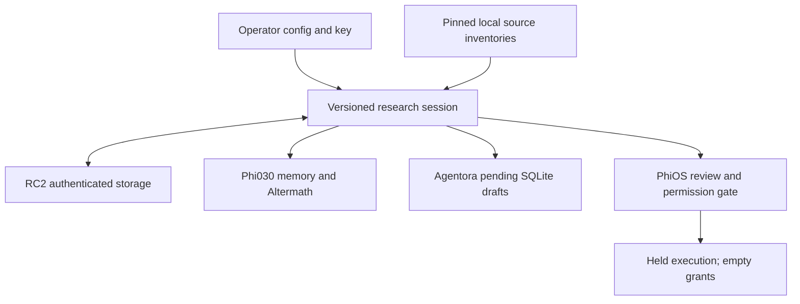

# Operation Genesis Ascension — Cycle III foundation v0.1

Prepared November 26, 2026. Controlling mission:
[`controlling-mission.md`](controlling-mission.md), SHA-256
`7ed718c4c6e2984049163c39c6f32559f50528601dbe2861e8b185ffdfdb0c22`.
This is an engineering evidence report, not independent verification or release
approval. Publication metadata and exact published head are recorded in the draft
PR and the final publication receipt; the source revision of this report is its
containing Git commit.

## Executive summary

Implemented and exercised a bounded first increment toward Φ035/Φ036: a versioned
local research session that actually runs the existing memory → Altermath →
Agentora draft → PhiOS review path. Unlike Φ034's separate illustrative accounting
journal, this session reserves work **before** invoking each actual operation,
accounts for its completed logical work and replay, persists artifacts, rejects
source/policy drift, and preserves uncertainty after interruption. Native PhiOS
PermissionGate supplies an explicit denial; no executor or live worker is used.
The changes belong entirely to PhiGenesis, with one small extraction of RC2's
existing authenticated storage constructor. Earlier experimental formats/results
remain intact. No other repository needs a speculative patch.

**The full Φ035–Φ043 roadmap is not complete. Production is BLOCKED.** Independent
witness administration, protected monotonic storage, package/host attestation,
native PhiMemory9/PocketMesh integration, full physical accounting, independent
scientific evaluation and native Windows qualification remain open. Synthetic
benchmark results include strong failures: Φ017 pocket adaptation collapses under
unexpected shift, and Φ030 context-tagged memory loses to recent memory in the
stationary regime. The new wrapper does not fix or conceal those results.

## Verified baseline and repository inventory

Before implementation, PR [#46](https://github.com/MichaelWave369/PhiGenesis/pull/46)
was verified **merged**. Exact head:
`83e4cdda931b27889b03c03bcdd050f43709daf2`; merge/default-branch baseline:
`bfedf68cbc7649adb13da97a78a61e68bbf3d970`. All **80 check-run records** returned
for that exact head concluded success. The empty legacy commit-status collection
was not mistaken for failed or missing Actions checks. Evidence:
[`pr46-baseline.json`](pr46-baseline.json).

Four pages of connected-account repository discovery returned 320 repositories.
The relevant sources were inspected at the revisions below. Inventory is a
time-bounded observation, not a permanent statement about default branches.

| Repository | Inspected default branch | Observed revision | Scope/status |
|---|---|---|---|
| [PhiGenesis](https://github.com/MichaelWave369/PhiGenesis) | main | `bfedf68cbc7649adb13da97a78a61e68bbf3d970` | VERIFIED: all Φ017–034 entry points plus RC1/RC2 reproduced locally |
| [PhiOS](https://github.com/MichaelWave369/PhiOS) | main | `43620d38d6164b3579d61784cdb140462501ff1f` | VERIFIED source inventory; execution tests use the older audited pin below |
| [Altermath](https://github.com/MichaelWave369/Altermath) | main | `99a40f6f8e6f4ded656dd3655778dfffa72a3754` | VERIFIED: Causal Belt contract, bridge and 12 native tests |
| [Agentora](https://github.com/MichaelWave369/Agentora) | main | `49166bb5365975d68df744678f91a837b0da48f2` | VERIFIED: actual offline plan/handoff persistence; no runtime worker calls |
| [PhiMemory9](https://github.com/MichaelWave369/PhiMemory9) | main | `5cba675a3a439023a3ff374c238dd6e4339e3a55` | VERIFIED: 124 native tests; no Genesis adapter in this increment |
| [NBGPocketMesh](https://github.com/MichaelWave369/NBGPocketMesh) | main | `0687f10970989194d4af554d9b189c7ce8a1ad15` | VERIFIED: six native R8 tests; its workload remains SIMULATED |
| [NestedBubbleGear](https://github.com/MichaelWave369/NestedBubbleGear) | main | `41cf5be77cdd9958db55ae8de4bab559f30d79e0` | IMPLEMENTED — UNVERIFIED: inspected finite relational/provenance research; no full suite run |
| [PhiBuddy](https://github.com/MichaelWave369/PhiBuddy) | main | `5832141379174938bdd4d5487c698e228ccb9537` | IMPLEMENTED — UNVERIFIED: inspected Rust/SQLite/Ollama interfaces; no inference invoked |
| [PhiDiscovery](https://github.com/MichaelWave369/PhiDiscovery) | main | `bb51df2fa556e9df1dba5bf14528ae725fc0fbc1` | IMPLEMENTED — UNVERIFIED: inspected evidence/assumption-review interfaces; no execution |
| [PhiDevelopmentalIntelligenceMesh](https://github.com/MichaelWave369/PhiDevelopmentalIntelligenceMesh) | main | `a6b92c9fc98f81940da6598adf61f280f70337ae` | IMPLEMENTED — UNVERIFIED: inspected optional developmental bridges; not imported |
| [Codex](https://github.com/MichaelWave369/Codex) | main | `c8db325fb881450ccda8a47072e31cb050afe43f` | IMPLEMENTED — UNVERIFIED: inspected symbolic research context; not a runtime dependency |
| [PhiShieldNetwork](https://github.com/MichaelWave369/PhiShieldNetwork) | main | `b3c2ed4ea841137a2ba8f7a1e650fcf5eb203533` | IMPLEMENTED — UNVERIFIED: README/branch inspected; observatory and simulated defense, not enforcement |

Related names resolved to actual interfaces rather than invented repositories:

| Mission name | Actual location | What is established |
|---|---|---|
| ΦMycelium | `NBGPocketMesh/src/phi-mycelium-r0.mjs` through `r8.mjs` | Finite synthetic routing/growth/circulation/orchestration; no physical holographic storage |
| NBG Pocket Mesh | `NBGPocketMesh` | Existing router, Album, signed gate and remote-anchor research interfaces |
| Infinite Holographic Pocket Squares | No exact named repository in this inventory; related finite pockets in Altermath/NBG | PROPOSED as an infinite/physical capacity claim; finite software analogues are SIMULATED |
| ΦPACT | `PhiOS/phios/phipact.py` | Offline synthetic evidence/scenario assessment; not operational authorization |
| ΦLedger | No exact repository found; existing PhiOS Spine/Mandala ledgers and `phios/ledger_reports/` | Distinct audit/report stores, not one interchangeable authority service |
| ΦShield | Closest actual repository: `PhiShieldNetwork` | Read-only public-source observatory and synthetic defense rehearsal; no production shield adapter |

Source/authority boundary receipt: [`build-boundary.json`](build-boundary.json).
The current PhiOS default branch was inspected separately from the historical
integration pin; the adapter does not falsely label current files with old SHAs.
No private PhiKernel/TIEKAT implementation was inspected, copied or imported.

### Dependencies and open work

Runtime dependency pins preserve Φ033's actual contract:

| Dependency | Required revision |
|---|---|
| historical PhiGenesis source manifest | `22114dc95ee56b49cd23a5eeff1b8a0a3d1d972e` |
| Agentora | `49166bb5365975d68df744678f91a837b0da48f2` |
| Altermath | `99a40f6f8e6f4ded656dd3655778dfffa72a3754` |
| PhiOS | `da87f8fe7d26036a61a97aca6eebc2afc2a747c3` |

The candidate uses Node standard libraries plus the explicitly pinned Python
dependency closure in [`requirements.txt`](../../runtime/cycle3/requirements.txt).
A fresh venv, without system site packages, executed the native adapters.
Python distribution versions are checked per worker; wheel bytes and interpreter
binaries are not authenticated. No Rust, browser build, cloud service or model is
required. CPU-first execution is VERIFIED on the stated Linux environment; GPU
acceleration and native Windows hardware qualification are not claimed.

Observed open work: PhiOS issue #340 concerns independent recovery/offline
acceptance; Agentora has nine open operational/fleet issues, including #124 and
#75; Altermath has open experimental PR #31. PhiGenesis had no open issues/PRs
at the baseline. These are inventory observations, not closure claims. No issues
or external systems were modified.

No root LICENSE file was present in PhiGenesis at baseline. This increment does
not choose a license on the owner's behalf or copy licensed dependency source
into the repository. An explicit root licensing decision remains necessary before
claiming a fully open-source-licensed release. Existing dependency licenses remain
their owners' licenses.

## Architecture and incompatible mechanisms

The trusted host owns the fixed six-operation sequence. Evidence cannot choose
module paths, execute code, raise ceilings, change evaluators, dispatch workers,
approve promotion or acquire permissions. Native adapters are imported from
audited local sources. This is a cooperative trusted-host boundary, not an OS
sandbox against a process that can change the runtime, keys or files.

| Existing mechanism | Overlap/incompatibility | Consolidation decision |
|---|---|---|
| RC1/RC2 HMAC checkpoint/journal | Finite learner schema and observation reservations; not Φ028 role signatures | Reuse its storage constructor only; preserve its schema and tests |
| Φ022–029 signed evolution/witness logs | Several event schemas, fixed planner/evaluator policies, differing units and key roles | Preserve histories and tests; do not relabel or silently migrate them |
| Φ030 snapshot | Deterministic reconstruction without authenticated observation truth | Native restore adapter; synthetic provenance stays visible |
| Φ031 Altermath receipts | Interpreter fuel is not comparison count; hashes are not authority | Separate counters; verify through the actual interpreter |
| Φ032 Agentora drafts | Pending plan/handoff records; executor hints are not worker execution | Reuse draft APIs in a new isolated DB; no team executor imported |
| Φ033 Covenant bridge | Descriptive transitions, unsigned identity and empty authority | Preserve those claims; add native PermissionGate denial, not a competing grant service |
| Φ034 acceptance association | Separate synthetic accounting log; association not durable work accounting | Replace this *demonstration path* with actual per-operation reservations; keep Φ034 unchanged |
| PhiMemory9 lifecycle/evidence | Native provenance-preserving SQLite graph differs from Φ030 numeric snapshots | Native integration remains PROPOSED; no lossy automatic migration |
| Mycelium R8 | Abstract steps/hops and unsigned fixture grants | Do not treat them as CPU resources or import grants into PhiOS |

All earlier experiments/results remain available for independent reproduction.
Only the generic RC2 create helper is extracted; seed/mode validation in the
original `initJournal` remains unchanged. Historical migrations are not complete:
unknown protocol versions fail closed instead of being coerced into this schema.

## Existing capability matrix: Φ017–Φ034

“VERIFIED” below describes reproduced local software contracts. The learning and
world results remain SIMULATED; this does not establish scientific generality.

| Milestone | Actual implementation and evidence | Scope/limitation |
|---|---|---|
| Φ017 | VERIFIED: `phi017-bounded-adaptation.mjs`, 334 assertions | SIMULATED finite routing; severe unexpected-shift failure |
| Φ018 | VERIFIED: `phi018-adaptive-resilience.mjs`, 8,342 assertions | SIMULATED refreshed labeled memory and supplied contexts |
| Φ019 | VERIFIED: `phi019-ancestral-recall.mjs`, 12,443 assertions | SIMULATED bounded ancestry/archive; not general graph execution |
| Φ020 | VERIFIED: `phi020-relational-evolution.mjs`, 1,050 assertions | SIMULATED finite same-index recombination |
| Φ021 | VERIFIED: `phi021-collaborative-evolution.mjs`, 889 assertions | SIMULATED peer records; not independently administered evidence |
| Φ022 | VERIFIED: real signature/evaluator/persistence harness | Same host owns roles; production sentinel fixed |
| Φ023 | VERIFIED: 53 continuity checks | Explicit abandonment; signed-anchor rollback limit reproduced |
| Φ024 | VERIFIED: 42 witness checks and process kills | Single-host witness; suffix rollback limit reproduced |
| Φ025 | VERIFIED: 71 planner checks, 37 integration checks | Advisory planner; static evaluation mismatch remains visible |
| Φ026 | VERIFIED: actual context-bound evaluator harness | Public designed fixture; no independent benchmark secrecy |
| Φ027 | VERIFIED: actual provenance/planner/evaluator harness | Authentication does not prove external observations |
| Φ028 | VERIFIED: attempted-work/storage/interruption harness | Planner/evaluator comparisons only; no complete integrated physical accounting |
| Φ029 | VERIFIED: 61 quorum checks | Honest-witness assumptions; coordinated rollback reproduced; no BFT |
| Φ030 | VERIFIED: 4,946 checks and cold restart | SIMULATED delayed/conflicting memory, supplied environmental tags |
| Φ031 | VERIFIED: 390 native bridge assertions, 96 retrievals | Actual finite interpreter on synthetic scalar votes; 3,168 primary fuel/events |
| Φ032 | VERIFIED: 132 assertions, 12 actual SQLite plans, 48 subgoals, 36 handoffs | No inference, tools or worker dispatch |
| Φ033 | VERIFIED: 158 assertions, 12 native reviews | 36 descriptive accepted transitions, 12 HELD execution transitions |
| Φ034 | VERIFIED: deterministic export, actual batch, nine crypto integration checks | Release still BLOCKED; synthetic accounting example did not measure integration |

RC1 finite-domain certification and RC2 crash-aware journaling both passed their
local suites. RC2's 12 actual process-kill cases and five additional storage checks
were rerun after extracting the shared create helper. This establishes process
crash behavior on the tested host, not physical power-loss durability.

## Implemented changes and requirement traceability

| Requirement | New implementation / verification | Status and remaining boundary |
|---|---|---|
| Φ035: versioned modular interface | `protocol.mjs`, fixed Node/Python adapters, explicit schemas, source/config binding, deterministic artifacts | VERIFIED for this narrow workflow; full replaceable evolutionary runtime and historical migration remain PROPOSED |
| Φ036: reservations and integrated accounting | `session.mjs`, separate nine-unit vectors/category allocations, conservation, durable start/result/abandon; killed processes and duplicate admissions tested | VERIFIED logical workflow accounting; physical CPU/RAM/I/O and all discovery workflows remain BLOCKED |
| Φ037: independent trust | Existing Φ029 locally reproduced; alternatives evaluated below | BLOCKED for genuine deployment; no fabricated independent identities or new production witness |
| Φ038: native governed memory | Actual PhiMemory9 source/interfaces and 124 tests inspected/reproduced | PROPOSED integration; Φ030 remains synthetic, native lifecycle/receipt mapping not implemented |
| Φ039: relational genome | Altermath/NBG finite operational semantics inspected | PROPOSED; no executable candidate genome or authority-bearing configuration introduced |
| Φ040: governed collaboration | Existing four-role Agentora draft/handoff integration reused | VERIFIED draft persistence only; live roles/inference/dispatch remain BLOCKED |
| Φ041: native authority mechanisms | Actual PhiOS PermissionGate and EffectBoundaryPolicy consulted; empty ceiling denies execution; forged command paths refused | VERIFIED local deny decision; live Spine/handoff/control-plane enforcement remains BLOCKED |
| Φ042: independent crucible | Tamper, drift, interruption, budget, cold restart and permission controls executed | VERIFIED engineering regressions; independent held-out tasks/evaluators/ablations remain PROPOSED |
| Φ043: local candidate | Startup/config/dependency manifest, deterministic demo, accounting, authority/provenance/recovery reports and blocked gate | VERIFIED bounded local demonstration; full integrated local research candidate remains PROPOSED |

No scope requirement was deleted or redefined to make tests pass. Selecting a
completed foundational increment follows mission §7's explicit instruction to
prefer substantive verified increments over superficial roadmap coverage. No
placeholder repository, live service, production release or external repo patch
was created.

## Actual tests and evidence

| Execution | Actual result | Evidence |
|---|---|---|
| Baseline Φ017–030 / RC1 / RC2 / Python tests | 20 commands passed; original Python suite: 38 tests | [`baseline.json`](baseline.json) |
| Pinned Φ031–034 pipeline | Six commands passed, including actual Node/Python/SQLite/crypto integration | [`integration-baseline.json`](integration-baseline.json) |
| Native related suites | PhiMemory9 124 tests; Altermath 12; Mycelium R8 six; all passed | [`related-baseline.json`](related-baseline.json) |
| New Cycle III suite | 19 tests passed, none skipped; dependency-free protocol controls plus full isolated-venv integration | [`cycle3-tests.json`](cycle3-tests.json) |
| New deterministic demonstration | Six actual operations, 19 HMAC records, native denial, no grants | [`cycle3-demo.json`](cycle3-demo.json) |
| Φ017 and Φ030 90-seed reproductions | Both reports run twice; each pair byte-identical | [`comparative-reproduction.json`](comparative-reproduction.json) |

The Cycle III integration includes two independent *session initializations*, not
independent researchers/administrations. It compares exact artifact hashes, then
performs two cold CLI inspections, duplicate admission refusals, actual SQLite
handoff permission drift, actual source modification/restoration, and three real
SIGKILL windows: after reservation, after start, and after SQLite work but before
journal result. An unrecorded completed draft remains uncertain/quarantined.

CI is configured in `cycle3-runtime.yml` for Ubuntu/Node 22/Python 3.11 and the
pinned dependency closure. Local execution is not labeled remote CI. Use the
publication receipt/PR checks for the exact published head's actual CI result;
no production approval follows from it. Not run: complete PhiOS/Agentora UI
suites, native Windows, GPUs/Ollama, external inference, physical failures,
independent witness administration or an external scientific evaluation.

## Comparative measurements and negative results

No new learning-performance advantage is claimed. The following results are
fresh reproductions of the unchanged authored synthetic benchmarks across all
90 declared seeds, with no favorable-seed filtering.

| Φ017 regime | Fixed accuracy | Flat accuracy | Pocket accuracy | Negative interpretation |
|---|---:|---:|---:|---|
| stationary | 87.75% | 95.83% | 95.59% | Pocket does not beat the strong flat selector here |
| specialized | 88.40% | 88.40% | 96.57% | Benefit depends on supplied factorization/regime |
| unexpected shift | 88.49% | 88.55% | **46.64%** | FAILED: admission does not ensure shift robustness; 76/90 pocket trials regress |

Fixed spends 4,860 mean comparisons, adaptive variants 12,636. These are not
matched total-compute claims: fixed evaluates once, adaptive search nine times.
Flat and pocket have equal search counts but different inductive biases.

| Φ030 regime | Recent accuracy | Age-weighted accuracy | Consolidated accuracy | Context-tagged accuracy |
|---|---:|---:|---:|---:|
| stationary | **80.15%** | 75.39% | 77.86% | 73.15% |
| recurrent | 57.98% | 60.28% | 51.80% | **67.77%** |
| delayed | 44.11% | 46.04% | 39.14% | **58.16%** |
| contradictory | 50.22% | 52.14% | 43.61% | **56.64%** |

FAILED: “context-tagged retention always improves memory.” It loses 7.00
percentage points to recent memory when stationary, where its two-tag partition
uses only half capacity. In delayed conditions its coverage is 80.63%, below
recent memory's 90.19%; abstention/missing answers count as wrong. Tags are
supplied perfect side information; automatic and imperfect context recognition
remain untested. Equal capacity is not equal execution cost. No statistical
significance, independent task collection or real-world accuracy is inferred.

### New integrated accounting

The deterministic single-packet run records these measured logical units:

| Unit | Measured |
|---|---:|
| Actual fixed adapter invocations | 6 |
| Generated synthetic fixture rows, including replay | 3,888 |
| Distance evaluations, including replay | 19,644 |
| Altermath interpreter fuel, including verification | 66 |
| Altermath receipt entries checked | 66 |
| Observed SQL statements | 274 |
| Source bytes explicitly hashed | 240,250,120 |
| Serialized IPC bytes | 100,910 |
| Artifact bytes | 49,326 |
| Journal bytes on disk | 76,649 |
| Isolated SQLite database bytes | 323,584 |

There are 432 original synthetic observation rows, 864 evaluation rows and 2,592
re-generated verification rows. Primary retrieval costs 30 additional distance
evaluations. Memory construction itself costs 6,528; two restores replay that
work, plus primary and verification translation costs. Fuel divides 33 primary
interpreter / 33 verification. These are actual software counters on synthetic
data, not physical observation acquisition or hardware energy measurements.

The executed receipt also records source bytes hashed, exact IPC/artifact bytes,
per-operation elapsed microseconds, current journal size and SQLite file size.
Those path/source-version-dependent numbers should be taken from that receipt,
not assumed constant across machines. Full-checkout hashing dominates much of
the wrapper overhead. FAILED as a current performance claim: this candidate has
not demonstrated a compute, latency or memory advantage over conventional direct
execution. Its advance is accountable integration and failure behavior.

Unstarted abandoned work becomes unused reservation; started abandoned work
remains uncertain reservation. Uncertain is a conservative bound, never a claim
that all reserved units were spent. Setup, imports, Git internals, OS caching,
cryptographic instruction costs, journal fsync latency/write amplification and
physical resource quotas are not fully metered. Raw counters are not collapsed
into a composite score.

## Security and trust assumptions

| Architecture considered | Available evidence | Decision / limitation |
|---|---|---|
| Same-host HMAC journal plus external head pin | Actual RC2 storage/recovery reused and tested | Chosen for this isolated research namespace only; key holder can forge coherent history; valid-prefix rollback without protected pin |
| Independent honest witnesses / remote anchor | Φ029 quorum reproduced; PocketMesh external-anchor/R13 source interfaces inspected | Candidate next trust boundary; requires independently administered keys/storage, authenticated session/artifact binding, rotation/revocation and disagreement rules; not deployed here |
| Hardware monotonic counter / separately protected checkpoint | No configured independent hardware/service in this session | PROPOSED alternative; do not simulate it into an independence claim |

Two matching witnesses out of three are not Byzantine consensus. Φ029 assumes
honest protected witnesses and a reader that does not suppress disagreement;
coordinated rollback of host-controlled state remains a reproduced limitation.
No real witness secrets, production keys or provider credentials are committed.

Current trusted components: local OS account/filesystem, runtime binary, audited
source roots/config, nominal Python distribution versions and the session HMAC
key. The new source inventory detects local drift under that model; it is not
remote attestation. Imports/counters/review reports are trusted software claims,
not authenticated external observations. The exported demo's HMAC head reports
what the executing trusted process verified; the discarded ephemeral key does
not make the committed report independently authenticated.

The writer lock prevents cooperative simultaneous CLI writers. A killed writer
requires explicit digest-bound unlock; a still-existing PID is refused. This is
not distributed locking, hostile process containment or multi-host serializability.
Inspection/recovery never reconstructs grants. Saved evidence does not grant
permissions. The native denial is a real local decision, not qualification of a
live execution integration. All four previous laws about capability, memory,
authentication and consensus—and the separate recovery/evaluation/release laws—
remain intact.

## Remaining blockers and next increments

| Priority | Next concrete increment | Acceptance evidence required |
|---|---|---|
| 1 | Independently protect the latest research checkpoint using an audited existing anchor interface | Separate administration/key custody; session/artifact binding; stale/fork/disagreement/rotation/revocation tests; no authority inherited on recovery |
| 2 | Add an explicitly approved, read-only native PhiMemory9 evidence adapter | Exact receipt/provenance preservation; contradictions, missing/delayed evidence, capacity and forgotten-source handling; no memory-as-permission |
| 3 | Expand accounting to Φ025 discovery and native memory, then physical diagnostics | Durable reservation per actual path; matched units; process-interruption and duplicate admission tests; source/package/environment attestation |
| 4 | Freeze an independent comparative crucible | Externally supplied held-out tasks, matched budgets, conventional baselines, supplied/inferred/imperfect contexts, misleading peers, saturation and seed-wide negative reporting |
| 5 | Qualify a live PhiOS boundary and native Windows target | Independently reviewed narrow handoff into existing authority plane; no alternate grants; control-plane isolation and platform filesystem/crash tests; explicit human authorization |

Genome/PocketMesh composition and model-assisted collaborative work should follow
those foundations; consensus among models is not independent corroboration.
Inference providers remain replaceable and are not introduced as identity or
memory stores. No downloads, system changes, live worker dispatch, merges or
deployments are part of this candidate.

## Reproduction, rollback and handoff

Use the [runtime guide](../../runtime/cycle3/README.md) for exact pinned setup,
configuration, deterministic startup, artifact/accounting inspection, two-phase
reserve/start, external pin checks and explicit unlock/abandon recovery. The
dependency-free protocol path needs Node only. Full integration runs offline
after explicit local dependency acquisition. Reproduce historical experiments
with their unchanged documented entry points and the commands in the evidence
receipts; no historical records are overwritten.

Discarding a disposable research session removes only that session's journal,
configuration snapshot and isolated draft database; preserve evidence if needed.
The source change is a scoped draft branch and can be reviewed/reverted through
normal Git review. No live databases, protected branches or deployment state were
modified.

**Research handoff:** candidate and detailed receipts are prepared for independent
proving-ground review. Local self-verification is not independent proof. Human
release authority remains with Michael Wayne Hughes. A green CI run does not
satisfy the missing production gates or authorize promotion.
